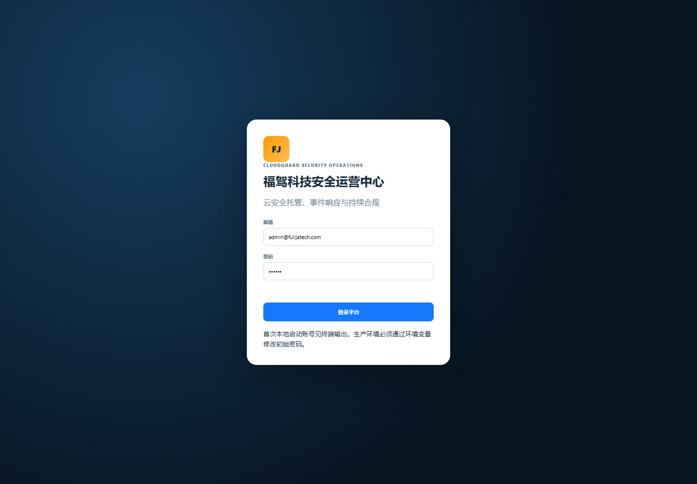
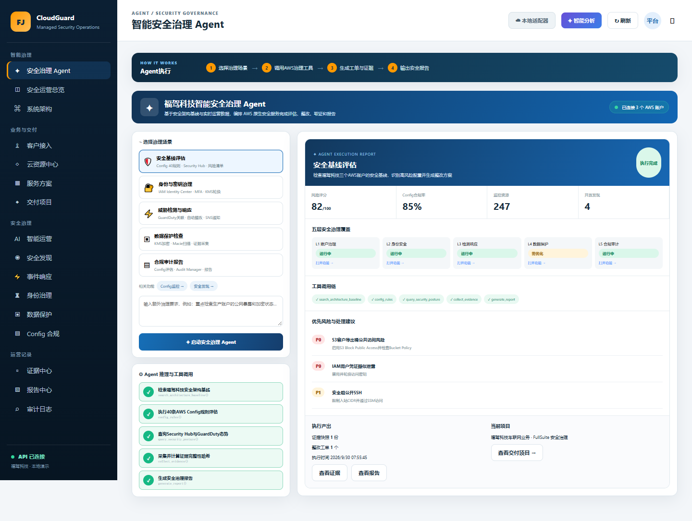
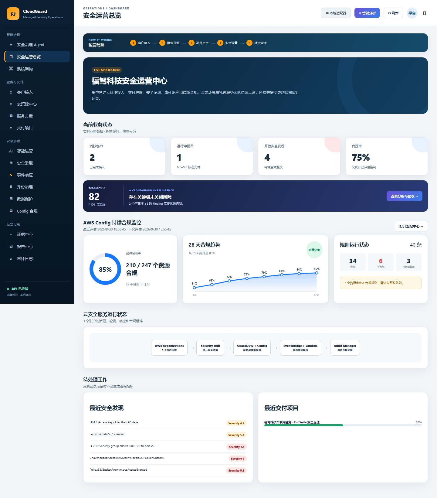
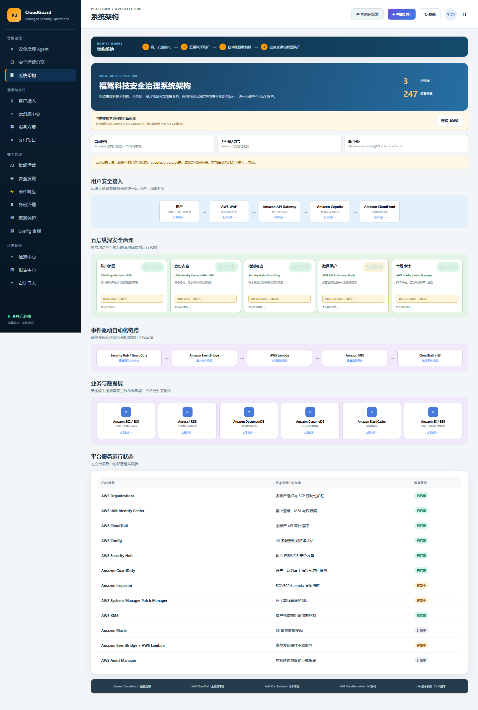
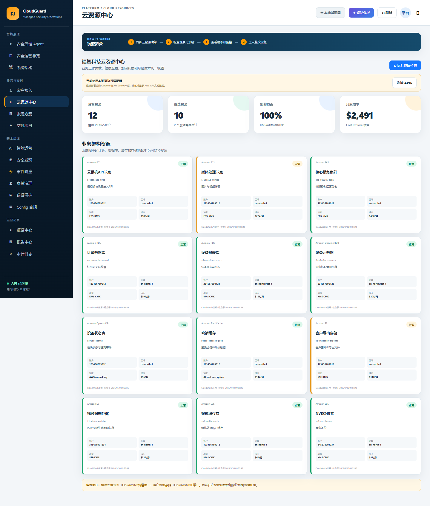
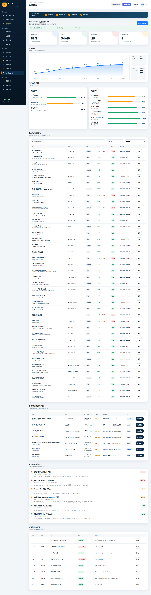
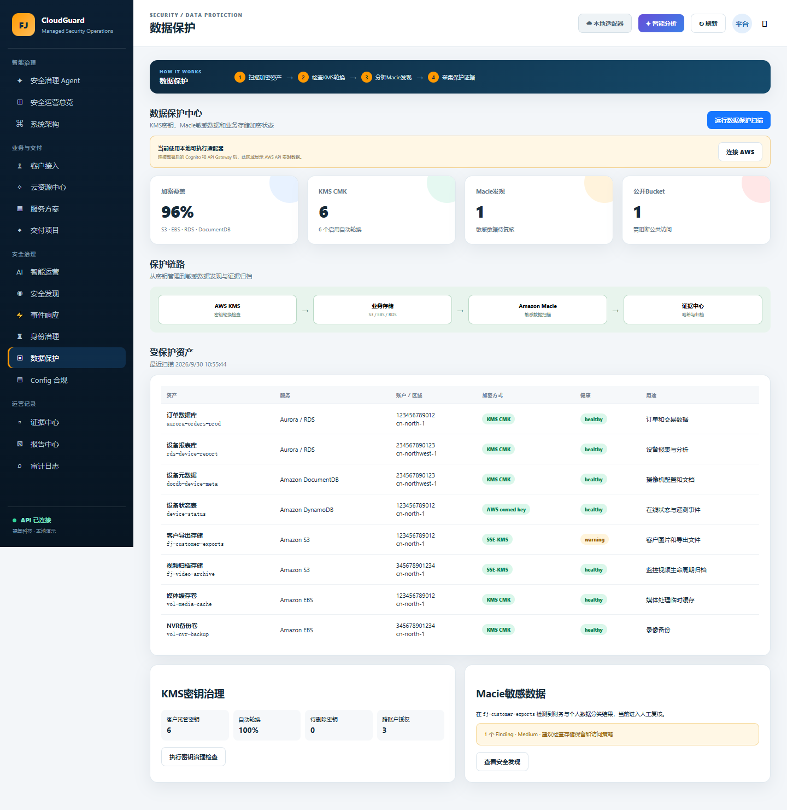
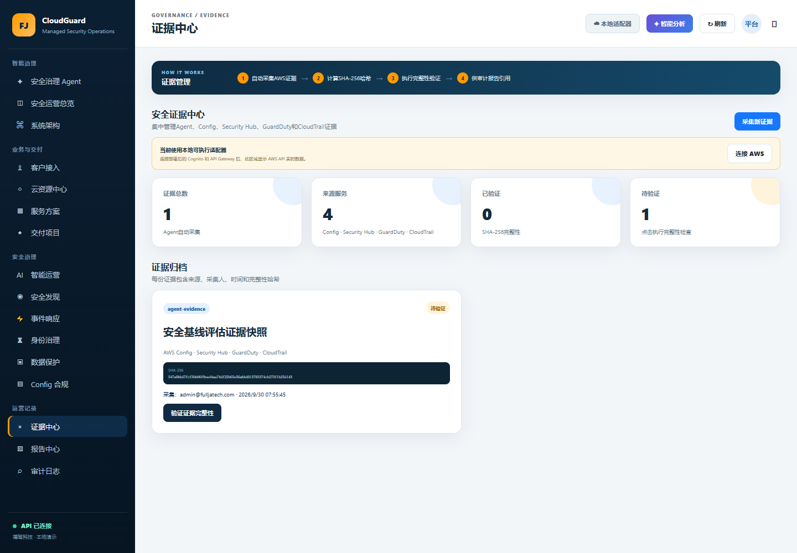
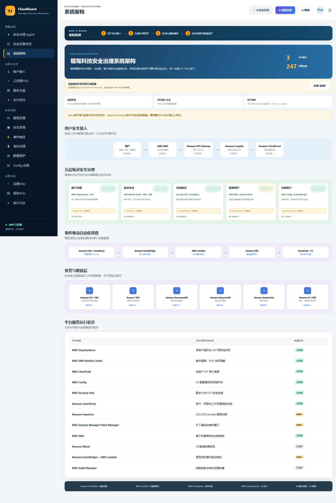
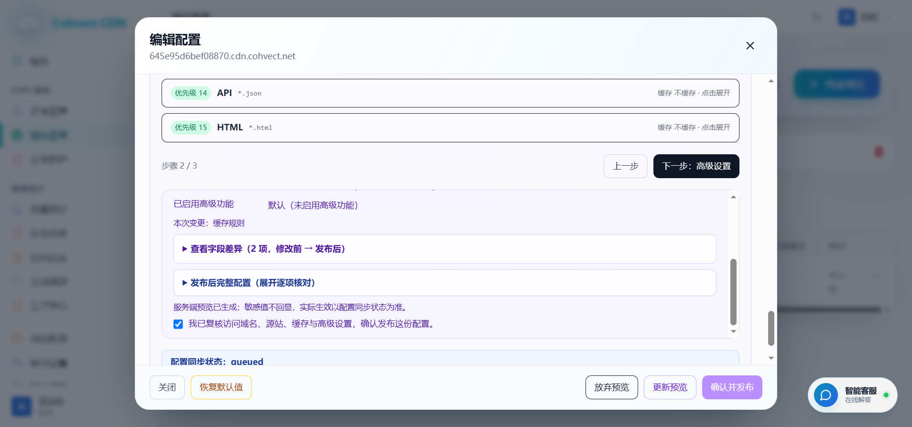

# 福驾科技 CloudGuard 方案使用说明书

**版本：** 1.0
**部署环境：** AWS 商业区 `ap-southeast-1`
**AWS 账号：** `893420598334`
**CloudFormation 栈：** `fullja-cloudguard-demo`
**运行模式：** 本地业务平台 + AWS 原生治理后端（Hybrid）
**编制日期：** 2026-09-30

## 1. 文档目的

本说明书用于指导福驾科技和托管服务团队运行 CloudGuard 安全治理平台，覆盖客户接入、项目交付、安全发现、事件响应、身份治理、数据保护、AWS Config 合规、证据归档、报告与审计，并说明 AWS 云端资源、五个 Agent 动作和日常操作方法。

本方案严格区分两类数据：

- **本地业务数据：** 客户、订单、项目、演示 Config 40 规则及工作流，持久化在 `data/store.json`；
- **AWS 实时数据：** 由 API Gateway/Lambda 调用 AWS Config、Security Hub、GuardDuty、IAM、KMS、S3、Macie、CloudWatch、Cost Explorer、CloudFormation 等真实 API 获取，并存入 DynamoDB/S3。

页面显示“本地适配器”时，不应将演示数值作为 AWS 账户证据；完成 Cognito 连接后，AWS 实时面板才代表云端采集结果。

## 2. 已部署架构

### 2.1 访问与身份

- AWS WAF：保护 API Gateway，启用 AWS Managed Common Rule Set 和 IP 限速；
- Amazon API Gateway：暴露治理 API；
- Amazon Cognito：Hosted UI、Authorization Code + PKCE、管理员身份和租户声明；
- Amazon CloudFront：已创建生产静态分发目标；当前完整业务流程仍由本地 Node.js API 提供，因此演示入口使用 `http://127.0.0.1:8080`。

### 2.2 计算、事件与数据

- 3 个 Python 3.12 ARM64 Lambda：Governance API、Finding Ingest、Scheduled Collector；
- EventBridge：接收 Security Hub、GuardDuty、AWS Config 事件，并每 6 小时启动采集；
- SQS + DLQ：Finding 缓冲、重试和失败隔离；
- DynamoDB：租户隔离单表，启用 KMS 加密和 PITR；
- S3 Evidence Bucket：KMS、Versioning、Object Lock、生命周期和访问日志；
- SNS：高危 Finding 和审批工单通知；
- CloudWatch：API 5XX、DLQ 告警与 Lambda 日志；
- AWS KMS：平台数据、队列、主题和证据加密，自动轮换。

### 2.3 部署输出

| 项目 | 值 |
|---|---|
| API | `https://0pdsacieja.execute-api.ap-southeast-1.amazonaws.com/prod/api` |
| Cognito | `https://fullja-cloudguard-893420598334-v2.auth.ap-southeast-1.amazoncognito.com` |
| User Pool | `ap-southeast-1_0HcOaKiFt` |
| CloudFront | `https://d15aa7dmkhmjnf.cloudfront.net` |
| Evidence Bucket | `fullja-cloudguard-demo-evidencebucket-cwtcmcin8vna` |
| DynamoDB Table | `fullja-cloudguard-demo-GovernanceTable-116BVFXB84ZTV` |

## 3. 启动与登录

### 3.1 启动本地业务平台

```powershell
Set-Location "c:\Users\hp\Desktop\福驾科技\smb-certification-demo"
npm start
```

浏览器访问：`http://127.0.0.1:8080`

本地管理员：

- 账号：`admin@fulljatech.com`
- 密码：`123456`

该密码仅用于本机演示。生产环境必须改用环境变量和强密码，不得复用该凭据。



### 3.2 连接 AWS 实时数据

1. 登录本地平台；
2. 点击右上角“本地适配器”或页面中的“连接 AWS”；
3. 浏览器跳转至 Cognito Hosted UI；
4. 使用 Cognito 管理员邮件收到的临时密码完成首次登录并设置强密码；
5. 建议启用 TOTP MFA；
6. 回调至本地平台后，右上角显示“AWS 已连接”；
7. 架构、资源、数据保护、证据和 Agent 动作开始调用真实 AWS API。

## 4. 核心页面操作

### 4.1 智能安全治理 Agent

Agent 提供五种治理场景：安全基线评估、身份与密钥治理、威胁检测与响应、数据保护检查、合规审计报告。选择场景、输入附加要求并点击“启动安全治理 Agent”，系统会展示工具调用链、风险摘要、工单、证据和报告。



五个云端动作：

| 动作 | 功能 | 是否修改客户资源 |
|---|---|---|
| `config_rules` | 读取 AWS Config 规则与合规状态并生成证据 | 否 |
| `rotate_keys` | 检查 IAM Access Key 与 KMS 轮换，Access Key 仅显示末四位 | 否 |
| `auto_remediate` | 聚合 Finding，创建 `approval_required` 工单并发送 SNS | 否 |
| `collect_evidence` | 并发采集 Config、Finding、KMS/S3/Macie 和拓扑 | 否 |
| `generate_report` | 汇总治理数据，调用 Bedrock 摘要或确定性回退引擎 | 否 |

`auto_remediate` 不直接执行破坏性整改。生产处置应由 Step Functions 人工审批后调用最小权限 Runbook。

### 4.2 安全运营总览

用于查看客户、项目、开放 Finding、事件、合规率、风险评分、Config 趋势和待处理事项。点击卡片或“打开监控中心”进入对应业务页面。



### 4.3 系统架构

系统架构页把访问层、五层纵深治理、事件驱动自动化、业务资源层和平台服务映射到具体页面与动作。每个层级均可点击进入功能，`config_rules()`、`rotate_keys()`、`auto_remediate()`、`collect_evidence()`、`generate_report()` 可直接执行。



### 4.4 云资源中心

展示 EC2/EKS、Aurora/RDS、DocumentDB、DynamoDB、ElastiCache、S3/EBS 等资源的健康、区域、加密、监控和成本。点击“执行健康检查”生成资源快照。AWS 连接后，实时面板显示 Resource Groups Tagging API、CloudWatch Alarm 和 Cost Explorer 结果。



### 4.5 AWS Config 合规

本地演示包含 40 条规则、247 个资源及趋势，用于演示筛选、整改和控制映射。AWS 实时连接后，以目标账户 API 返回为准。本次部署验收中，`ap-southeast-1` 实际返回 0 条 Config 规则，因此不得把本地 40 条规则宣称为该账户已部署规则。

操作步骤：

1. 查看合规率、规则状态、服务/账户分布；
2. 通过规则名、状态和服务筛选；
3. 打开规则详情查看命中资源；
4. 发起整改生成工单；
5. 审批后再执行生产变更；
6. 重新评估并关联证据。



### 4.6 数据保护

点击“执行保护扫描”检查 KMS 轮换、S3 加密、公共访问阻止和 Macie Finding。云端实现对 KMS 和 S3 独立只读请求进行并发采集，以控制响应时间。



### 4.7 证据中心

证据采集流程：调用 AWS API → 规范化 JSON → 计算 SHA-256 → 写入启用 Object Lock 的 S3 → 保存 Version ID 和元数据 → 写入 DynamoDB 索引。点击“验证证据完整性”会重新读取指定 S3 版本并比较哈希。



### 4.8 其他业务页面

- **客户接入：** 建立客户档案、SMB 资格、账户连接和跨账户授权；
- **服务方案：** 选择服务包并生成订单；
- **交付项目：** 按 M0–M5 更新里程碑和验收；
- **智能运营：** 查看可解释风险评分和 Copilot 建议；
- **安全发现：** 录入或接收 Finding，创建事件；
- **事件响应：** 生成计划、DRY_RUN、处置和时间线；
- **身份治理：** MFA/RBAC/SCP 基线与访问复核；
- **报告中心：** 生成、下载和归档治理报告；
- **审计日志：** 查询关键操作、对象、工单和证据关联。

## 5. 云端验收结果

| 验收项 | 结果 |
|---|---|
| `sam validate --lint` / `sam build` | 通过 |
| CloudFormation 栈 | `UPDATE_COMPLETE` |
| 五个治理动作 | 全部通过，无 Lambda FunctionError |
| `rotate_keys` 响应时间 | 约 17.9 秒 |
| 定时采集器 | 通过，首次约 70.8 秒；优化后改为并发采集 |
| Cognito Authorizer | 未认证请求返回 HTTP 401 |
| WAF | 已关联 API Gateway `prod` Stage |
| SQS Finding Ingest | 高危 `SMOKE_TEST` Finding 成功入库 |
| SNS | 高危事件发布成功 |
| DynamoDB | AgentRun、Audit、CollectionRun、Evidence、Finding、WorkOrder 已持久化 |
| S3 Evidence | 7 个版本化证据对象，`aws:kms` 加密 |
| SHA-256 验证 | 计算值与期望值一致 |
| API 5XX Alarm | `OK` |
| DLQ 隔离与告警 | 故意格式错误消息成功进入 DLQ 并触发告警，测试消息随后已清理 |

云端观测快照：14 个 IAM 用户、30 个 KMS 密钥、100 个 S3 桶抽样、40 个 CloudFormation 栈资源；完整 Access Key ID 不再输出，仅保留末四位和状态。

## 6. 运维与安全要求

- 每日检查 Finding、Incident、DLQ、API 5XX 和证据采集状态；
- 每周复核 P0/P1 工单、长期 Access Key、KMS 轮换和公网暴露；
- 每月生成治理报告、验证证据哈希、复核成本和权限；
- 使用短期 AWS Login/SSO，不保存长期 Secret Access Key；
- 所有生产整改必须审批、DRY_RUN、回滚方案和审计记录齐备；
- 不在报告或截图中显示令牌、Secret Key、完整 Access Key ID 或客户敏感数据；
- 当前账户的实时扫描范围包含账户级资源，正式交付应使用跨账户只读角色和租户范围过滤。

## 7. 常见问题

### AWS 实时面板读取失败

确认 `cloud-config.js` 为 `hybrid`、Cognito Token 未过期、回调地址为 `http://localhost:8080/`，并检查 API Gateway 与 Lambda 日志。

### 页面显示本地 40 条 Config 规则

这是业务演示数据。点击“连接 AWS”后读取真实 AWS Config；若云端仍为 0，应在目标账户部署 Config Recorder、Delivery Channel 和规则/Conformance Pack。

### Agent 动作只生成审批工单

这是安全设计。`auto_remediate` 不直接改动客户资源，避免未经授权的隔离、停机或权限删除。

### DLQ 告警

先查看消息和 Ingest Lambda 日志，确认消息来源与格式，修复后重放；不得直接清空包含未知真实事件的队列。

## 8. 费用与删除

主要费用来源：AWS WAF、KMS、CloudWatch Alarm、CloudFront、API Gateway、Lambda、DynamoDB、S3、SQS/SNS，以及账户中已启用的 Config、Security Hub、GuardDuty、Macie 和 Bedrock。

删除命令：

```powershell
.\scripts\destroy.ps1 -Region "ap-southeast-1" -StackName "fullja-cloudguard-demo"
```

DynamoDB、治理 KMS 密钥、Evidence Bucket 和 Access Log Bucket 设置为 `Retain`，删除业务栈后仍会保留并可能计费。必须先核对数据保留义务，再经授权单独删除。部署制品桶由 `fullja-cloudguard-deployment-bucket` 栈管理并设置 `Retain`。

## 9. 关联文件

- `template.yaml`：主 SAM/CloudFormation 模板；
- `deployment-bucket.yaml`：满足组织标签策略的部署制品桶；
- `cloud/`：Lambda 实现；
- `cloud-config.js`：当前混合模式端点；
- `AWS_DEPLOYMENT.md`：部署与云端验收；
- `ARCHITECTURE_IMPLEMENTATION.md`：架构节点实现映射；
- `docs/deployment-validation.json`：本次部署验收摘要；
- `docs/screenshots/`：平台截图。

## 10. EC2 与 Cohvect 公网 HTTPS 部署

### 10.1 公网入口

完整 DEMO 已部署到 AWS EC2，并通过 Cohvect CDN 提供公网 HTTPS：

- 访问地址：`https://645e95d6bef08870.cdn.cohvect.net`
- EC2 实例：`i-01d291825e0ba4fe4`，`t4g.nano`
- 公网 IP：`54.169.151.34`
- 源站域名：`ec2-54-169-151-34.ap-southeast-1.compute.amazonaws.com`
- CloudFormation 栈：`fullja-cloudguard-ec2`
- 备份桶：`fullja-cloudguard-ec2-backupbucket-h4oqbtm58jrw`




### 10.2 Cohvect CDN 配置

Cohvect 分配域名 `645e95d6bef08870.cdn.cohvect.net`，平台证书提供可信 HTTPS。源站使用 HTTP:80；默认规则和 15 条路径规则全部 TTL=0，避免登录、Token、Bootstrap 与业务 API 被缓存。Allowed Methods 包含 GET、HEAD、OPTIONS、PUT、POST、PATCH、DELETE；Cached Methods 仅 GET、HEAD。默认行为通过 legacy forwarding 白名单转发 Authorization 和 Content-Type，全部转发 Cookie 与 Query String。



### 10.3 数据保留与实时回滚

- `store.json` 每 15 分钟上传到启用 Versioning 的 S3；
- 非当前版本保留 90 天，SSE-S3 加密并阻止公共访问；
- 新版本发布前自动备份数据；
- `/opt/fullja/current` 与 `/opt/fullja/previous` 通过原子软链接切换；
- `sudo /usr/local/bin/fullja-rollback` 实测回退约 1.105 秒，恢复最新版约 1.096 秒；
- `sudo /usr/local/bin/fullja-data-rollback <version-id>` 可按 S3 Version ID 恢复数据，恢复前再次备份并校验 JSON；
- 发布命令：`.\scripts\deploy-ec2-release.ps1`。

### 10.4 成本和网络风险

实例使用按需 `t4g.nano`、8 GiB gp3、Standard CPU Credits，不使用 EIP、ALB 或 NAT Gateway。AWS Budget 设置为每月 12 USD，预算只告警不会自动停机。按用户确认的 D 方案，Security Group 向 `0.0.0.0/0` 开放 80 和 443，未开放 22；该配置会受到互联网扫描，可能产生额外流量费用。三个月结束前必须复核是否继续运行或收敛源站入站范围。

### 10.5 公网验收

公网 HTTPS 已验证：TLS 成功、首页 200、POST 登录成功、Authorization Token 可经 CDN 转发、Bootstrap 返回管理员和完整业务数据、连续健康请求均为 CDN Miss 且 `Cache-Control: no-store`。Cognito Callback/Logout 和 API Gateway CORS 均更新为 Cohvect HTTPS 域名。
